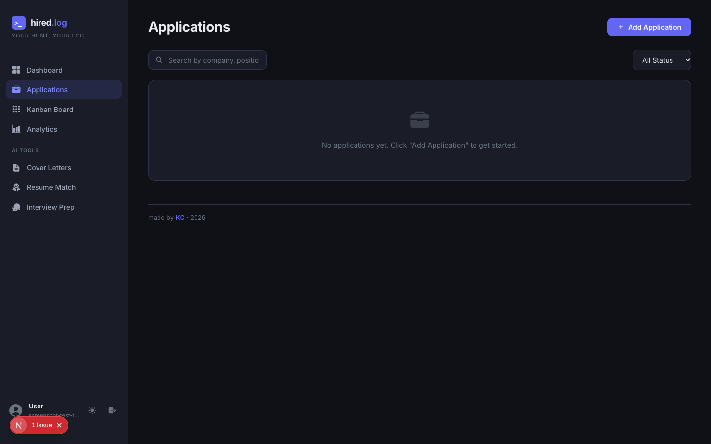
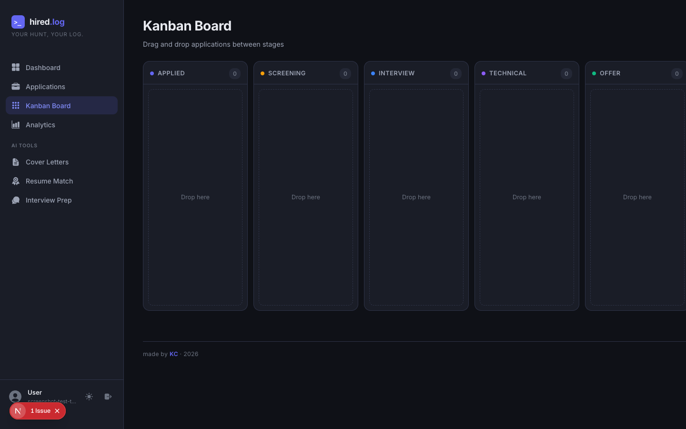
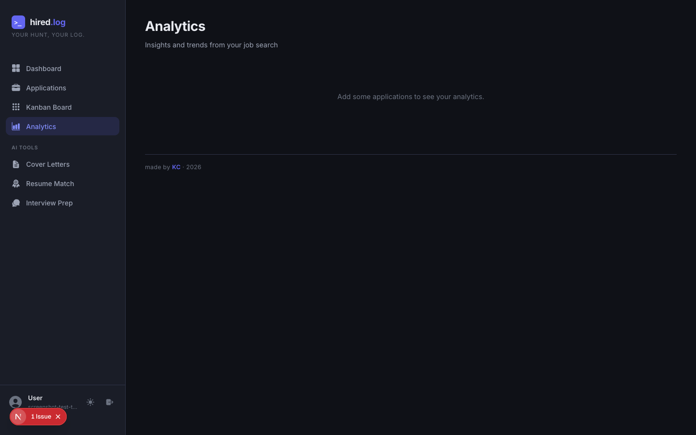
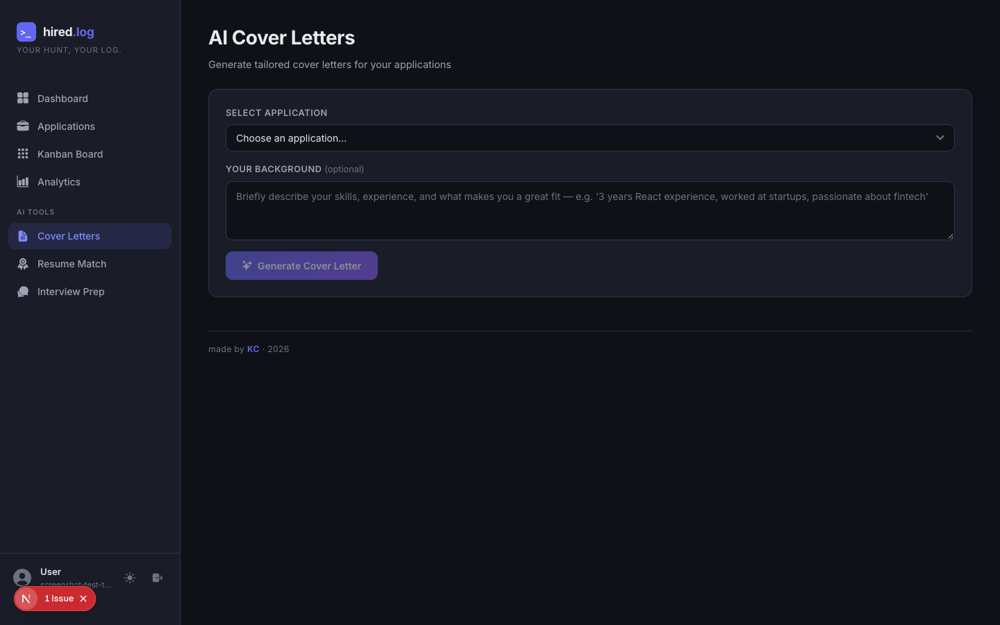
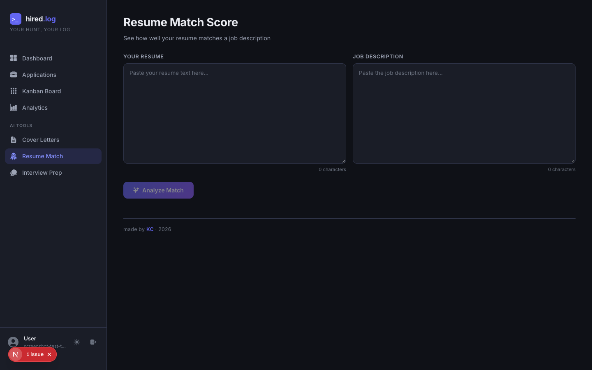
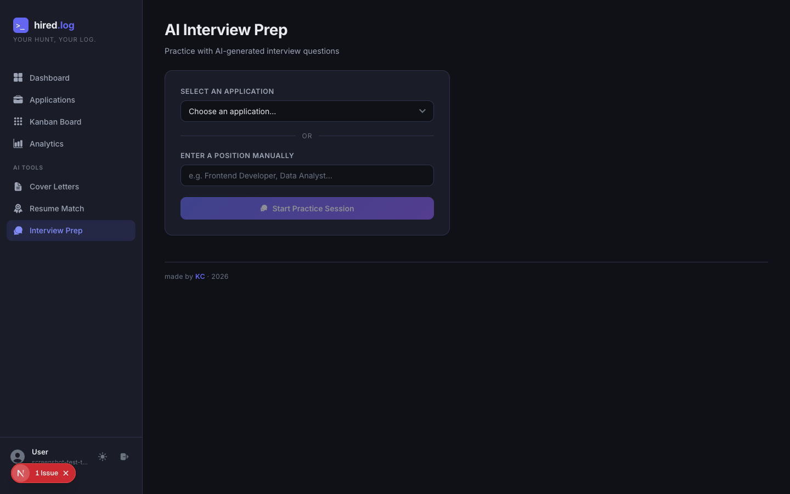
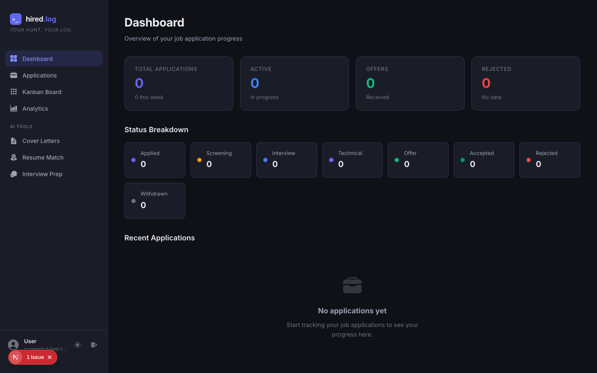

# hired.log — AI-Powered Job Application Tracker

A full-featured job hunting tracker built with Next.js, TypeScript, SCSS, and Firebase. Track applications, visualize your pipeline, analyze trends, and get AI-powered tools to level up your job search.

**Live app:** [hired-log.vercel.app](https://hired-log.vercel.app)

---

## Screenshots

| Dashboard | Applications |
|:---:|:---:|
|  |  |

| Kanban Board | Analytics |
|:---:|:---:|
|  |  |

| AI Cover Letters | Resume Match Score |
|:---:|:---:|
|  |  |

| AI Interview Prep | Login |
|:---:|:---:|
|  |  |

---

## Features

### Core Tracking

| Feature | Page/View | Key Files |
|---|---|---|
| **Dashboard** | `/` → Dashboard | `src/components/Dashboard.tsx` |
| **Application List** | `/` → Applications | `src/components/ApplicationList.tsx` |
| **Add / Edit Applications** | Modal overlay | `src/components/ApplicationModal.tsx` |
| **Search, Filter & Sort** | Applications view | `src/components/ApplicationList.tsx` |
| **Bulk Actions** | Applications view | `src/components/ApplicationList.tsx` |
| **CSV Export** | Applications view | `src/lib/export.ts` |
| **Kanban Board** | `/` → Kanban Board | `src/components/KanbanBoard.tsx` |
| **Analytics & Insights** | `/` → Analytics | `src/components/Analytics.tsx` |

### Application Details

| Feature | Key Files |
|---|---|
| **Interview Tracking** | `src/types/application.ts`, `src/components/ApplicationModal.tsx` |
| **Activity Timeline** | `src/types/application.ts`, `src/app/page.tsx` |
| **Follow-up Date** | `src/components/ApplicationList.tsx`, `src/components/ApplicationModal.tsx` |
| **Job Source** | `src/types/application.ts`, `src/components/ApplicationModal.tsx` |
| **Duplicate Detection** | `src/app/page.tsx` |

### Custom Statuses

| Feature | Key Files |
|---|---|
| **Manage Pipeline Statuses** | `src/components/ManageStatusesModal.tsx`, `src/lib/userSettings.ts` |

### AI Tools (all powered by Gemini)

| Feature | Page/View | Key Files |
|---|---|---|
| **AI Auto-Fill** | Add Application modal | `src/components/ApplicationModal.tsx`, `src/app/api/ai/extract/route.ts` |
| **AI Cover Letters** | `/` → Cover Letters | `src/components/CoverLetterGenerator.tsx`, `src/app/api/ai/cover-letter/route.ts` |
| **Resume Match Score** | `/` → Resume Match | `src/components/ResumeMatchScore.tsx`, `src/app/api/ai/resume-match/route.ts` |
| **AI Interview Prep** | `/` → Interview Prep | `src/components/InterviewPrep.tsx`, `src/app/api/ai/interview-prep/route.ts` |

### Browser Extension

| Feature | Key Files |
|---|---|
| **Save from LinkedIn** | `extension/content/content.js` |
| **Save from Indeed** | `extension/content/content.js` |
| **Save from Kalibrr** | `extension/content/content.js` |

---

## Feature Details

### Dashboard
Stats overview: total applications, active count, offers, rejections, rejection rate, and "this week" count. Status breakdown with color-coded dots and a list of the 5 most recent applications.

### Application List
Sortable table (company, status, date applied) with search by company/position/location, status filter, and responsive mobile card view. Full CRUD with ownership-verified updates and deletes.

### Kanban Board
Drag-and-drop visual pipeline across all status columns. Drop a card to update its status directly in Firestore. Click any card to open the edit modal. Column order and labels reflect your custom statuses.

### Bulk Actions
Select multiple applications with checkboxes, then bulk-delete or bulk-change status in one action. A floating action bar appears at the bottom of the list when any rows are selected.

### CSV Export
One-click export of all applications to a dated CSV file (`hired-log-YYYY-MM-DD.csv`). Includes company, position, location, work mode, status, source, dates, salary, URL, contact info, notes, and interview entries.

### Interview Tracking
Log interviews directly on each application — record the date, type (Phone Screen, Technical, Behavioral, Onsite, Other), and optional notes per round.

### Activity Timeline
Automatic audit trail per application. Events are recorded on creation, every status change, interview additions, and note edits, with timestamps. Visible in the edit modal.

### Follow-up Date
Set a follow-up reminder date on any application. Overdue follow-ups are highlighted in red in the list view.

### Job Source
Track where you found each listing — LinkedIn, Indeed, Glassdoor, Referral, Company Website, Handshake, or Other.

### Duplicate Detection
When adding a new application, the app checks for an existing entry with the same company and position and shows a non-blocking warning toast if one is found.

### Custom Statuses
Manage your own pipeline stages via the Manage Statuses modal. Add new statuses with a custom label and color, rename or recolor existing ones, reorder by drag-and-drop, and delete any stage. Statuses are saved per user in Firestore and apply across the app (list, kanban, filters, analytics, CSV export). Default statuses (Applied, Screening, Interview, Technical, Offer, Accepted, Rejected, Withdrawn) are restored if the list is cleared.

### Analytics & Insights
- **Rate cards:** Response rate, interview rate, offer rate, average days active
- **Weekly activity chart** (last 8 weeks, bar chart)
- **Monthly trend chart** (last 6 months, bar chart)
- **Application funnel** (horizontal bar per stage)
- **Work mode distribution** (Remote / On-site / Hybrid / WFH)
- **Top companies** by application count
- **Status overview** grid with counts and percentages

### AI Auto-Fill
Inside the Add Application modal — paste job description text or upload/paste a screenshot. Gemini extracts company, position, location, work mode, salary, contact, and notes automatically. Validates that the content is actually a job posting before extracting.

### AI Cover Letters
Select any tracked application, optionally add a short background blurb, and generate a tailored 3–4 paragraph cover letter via Gemini. Includes customization tips and one-click copy.

### Resume Match Score
Paste your resume text and a job description. Gemini returns:
- **Match score** (0–100%) with color-coded verdict
- **Matched skills** — keywords in both
- **Missing skills** — keywords in the job but not your resume
- **Key strengths** for this role
- **Actionable suggestions** to improve the resume

### AI Interview Prep
Select an application or type a position manually. Gemini generates 8 tailored questions (behavioral, technical, situational) with difficulty ratings and tips. Type your answer, click "Get Feedback" for star-rated evaluation, key points you should cover, and an example stronger answer.

### Chrome Extension
Floating "Save to JobTracker" button appears on LinkedIn, Indeed, and Kalibrr job pages. Scrapes job title, company, location, and work mode, then writes directly to Firestore via the REST API.

---

## Tech Stack

| Layer | Technology |
|---|---|
| Framework | Next.js 16 (App Router) |
| Language | TypeScript, SCSS Modules |
| Auth | Firebase Auth (Email/Password + Google) |
| Database | Cloud Firestore |
| AI | Gemini (via Google AI REST API, server-side) |
| Hosting | Vercel |
| Icons | react-icons (Ionicons) |
| Notifications | react-hot-toast |
| Extension | Chrome Manifest V3 (vanilla JS) |

---

## Project Structure

```
src/
├── app/
│   ├── api/
│   │   └── ai/
│   │       ├── extract/          # AI auto-fill from text or screenshot
│   │       ├── cover-letter/     # AI cover letter generation
│   │       ├── resume-match/     # Resume vs job description scoring
│   │       └── interview-prep/   # Question generation + answer evaluation
│   ├── layout.tsx
│   └── page.tsx                  # Main app shell + routing + sidebar
├── components/
│   ├── Dashboard.tsx
│   ├── ApplicationList.tsx
│   ├── ApplicationModal.tsx
│   ├── ManageStatusesModal.tsx   # Custom pipeline status editor
│   ├── KanbanBoard.tsx
│   ├── Analytics.tsx
│   ├── CoverLetterGenerator.tsx
│   ├── ResumeMatchScore.tsx
│   ├── InterviewPrep.tsx
│   ├── AuthPage.tsx
│   ├── AuthProvider.tsx
│   ├── StatusBadge.tsx
│   ├── DeleteConfirmModal.tsx
│   └── ThemeToggle.tsx
├── lib/
│   ├── firebase.ts
│   ├── applications.ts
│   ├── export.ts                 # CSV export
│   ├── userSettings.ts           # Per-user Firestore settings (statuses)
│   └── sanitize.ts
├── styles/
│   ├── globals.scss
│   ├── _variables.scss
│   ├── layout.module.scss
│   ├── dashboard.module.scss
│   ├── applications.module.scss
│   ├── modal.module.scss
│   ├── kanban.module.scss
│   ├── analytics.module.scss
│   ├── cover-letter.module.scss
│   ├── resume-match.module.scss
│   ├── interview-prep.module.scss
│   ├── manage-statuses.module.scss
│   └── auth.module.scss
└── types/
    └── application.ts            # JobApplication, CustomStatus, Interview, TimelineEvent

extension/
├── manifest.json
├── background/background.js
├── content/content.js
└── popup/popup.js
```

---

## Getting Started

### 1. Install dependencies

```bash
npm install
```

### 2. Configure environment variables

Create a `.env.local` file at the project root:

```
# Firebase (client-side, public)
NEXT_PUBLIC_FIREBASE_API_KEY=
NEXT_PUBLIC_FIREBASE_AUTH_DOMAIN=
NEXT_PUBLIC_FIREBASE_PROJECT_ID=
NEXT_PUBLIC_FIREBASE_STORAGE_BUCKET=
NEXT_PUBLIC_FIREBASE_MESSAGING_SENDER_ID=
NEXT_PUBLIC_FIREBASE_APP_ID=

# Gemini API key (server-side, never exposed to client)
GEMINI_API_KEY=

# App URL (used for SEO/metadata)
NEXT_PUBLIC_APP_URL=http://localhost:3000
```

Get a Gemini API key at [aistudio.google.com](https://aistudio.google.com) — keys start with `AIza`.

### 3. Firebase Console Setup

1. **Authentication** — Enable Email/Password and Google sign-in methods
2. **Firestore** — Create a database (Standard edition, nearest region)
3. **Security Rules** — Publish the rules from `firestore.rules`
4. **Composite Index** — Create an index on the `applications` collection: `userId` (Ascending) + `createdAt` (Descending)

The app uses two Firestore collections: `applications` (one document per job entry) and `userSettings` (one document per user, stores custom statuses).

### 4. Run the app

```bash
npm run dev
```

---

## Security

### Authentication & Authorization

- Firebase Auth guards all data — unauthenticated users see only the login page
- Every Firestore document is tagged with `userId`; queries only return documents owned by the authenticated user
- Pre-write ownership check: before update/delete, the app reads the document first and verifies `userId` matches

### Firestore Security Rules

- Ownership enforced at the database level (`resource.data.userId == request.auth.uid`)
- Required fields, correct types, and max lengths validated by rules
- `status` and `workMode` validated against strict enums
- Catch-all deny for any path not explicitly allowed

### Input Sanitization (server-side)

All Gemini API routes validate and sanitize inputs before calling the external API. Application data is trimmed, length-capped, and enum-validated before any Firestore write.

### HTTP Security Headers

Configured in `next.config.ts`:

| Header | Value |
|---|---|
| `X-Frame-Options` | `DENY` |
| `X-Content-Type-Options` | `nosniff` |
| `Strict-Transport-Security` | `max-age=63072000; includeSubDomains; preload` |
| `Referrer-Policy` | `strict-origin-when-cross-origin` |
| `Permissions-Policy` | `camera=(), microphone=(), geolocation=()` |

---

## Deployment

```bash
npm install -g vercel
vercel
```

Add all `.env.local` variables in Vercel's project settings under Environment Variables. The `GEMINI_API_KEY` is server-only — never prefix it with `NEXT_PUBLIC_`.
